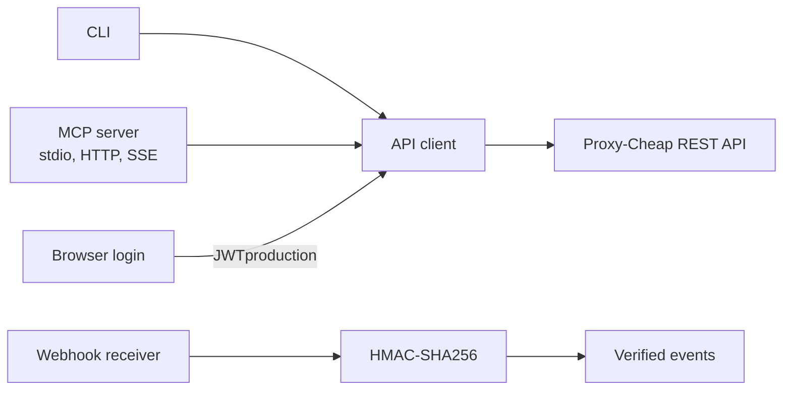

<div align="center">

# proxy-cheap-mcp

**The Proxy-Cheap API, from the terminal and from your agent.**

A Rust CLI and [Model Context Protocol](https://modelcontextprotocol.io/) server for [Proxy-Cheap](https://proxy-cheap.com/).

[](https://github.com/hongkongkiwi/proxy-cheap-mcp/actions/workflows/ci.yml)
[](LICENSE)
[](https://www.rust-lang.org/)
[](https://modelcontextprotocol.io/)

</div>

> Unofficial project. Not affiliated with Proxy-Cheap.

[Install](#install) · [Authenticate](#authenticate) · [Quick start](#quick-start) · [MCP server](#model-context-protocol) · [CLI reference](#cli-reference) · [Skill](#agent-skill) · [Webhooks](#webhooks) · [Configuration](#configuration-and-security) · [API coverage](#api-coverage) · [Development](#development)

## What it does

One binary covers all 24 Proxy-Cheap REST endpoints, serves 25 MCP tools, captures a dashboard session in a real browser, receives webhooks, and ships an agent skill.

The client handles the parts of the API that are easy to get wrong. Rotating plans take `traffic` instead of a `period`, IPv6 plans take `packageId`, static residential IPv4 plans accept regions and cities, and some authenticated endpoints answer with a login redirect instead of a `401`.

| Surface | What you get |
| --- | --- |
| CLI | 24 REST operations, JSON or table output, scriptable exit codes |
| MCP | 25 typed tools over stdio, Streamable HTTP, and legacy HTTP+SSE |
| Login | Browser capture of the dashboard session, validated before it is stored |
| Webhooks | HMAC-SHA256 verification and a receiver for all four events |
| Skill | A bundled `SKILL.md` with the ordering workflow and safety rules |



## Install

Rust 1.85 or newer is required. Browser login needs Chrome, Edge, Brave, or Chromium. The rest of the CLI does not need a browser.

```bash
cargo install --git https://github.com/hongkongkiwi/proxy-cheap-mcp
```

Or clone and build a release binary:

```bash
git clone https://github.com/hongkongkiwi/proxy-cheap-mcp
cd proxy-cheap-mcp
cargo build --release
./target/release/proxy-cheap --help
```

## Authenticate

There are two credential types. API keys take precedence when both are configured.

| Method | Best for | Lifetime |
| --- | --- | --- |
| Browser login | Getting started without creating keys | About 30 days |
| API keys | CI and long-running automation | Until revoked |

### Browser login

```bash
proxy-cheap login
```

This opens a compact Chrome or Edge app window at the dashboard login page, without tabs or an address bar. Log in normally, including any Cloudflare check. The CLI waits for the `JWTproduction` session cookie, closes the window, validates the token with `GET /account/balance`, and stores it in `~/.config/proxy-cheap/config.toml` with mode 0600 on Unix. Requests use `Authorization: Bearer`.

```bash
proxy-cheap login --environment staging   # staging dashboard
proxy-cheap login --force                 # replace an existing token
proxy-cheap login --browser "/Applications/Microsoft Edge.app/Contents/MacOS/Microsoft Edge"
proxy-cheap config show                   # auth method, environment, expiry
proxy-cheap logout                        # remove the token
proxy-cheap logout --browser-data         # also delete the browser profile
```

The login window uses a dedicated profile at `~/.config/proxy-cheap/browser-profile`, separate from your normal browser. Chrome, Edge, Brave, and Chromium are detected automatically; override the choice with `--browser` or `PROXY_CHEAP_BROWSER`. The first login may require a Cloudflare check once, after which the clearance stays in that profile. Dashboard session tokens typically expire after about 30 days.

The environment and API base are stored with the token, so later commands use the same host. On macOS, an older config at `~/Library/Application Support/proxy-cheap/config.toml` is migrated to `~/.config/proxy-cheap/config.toml` on first load.

A session token is a dashboard credential, not a scoped API key. Keep the config file private. `logout` removes the token but keeps API keys; `logout --browser-data` also deletes the profile and its cookies.

### API keys

Create keys at https://app.proxy-cheap.com/api-keys.

```bash
export PROXY_CHEAP_API_KEY=...
export PROXY_CHEAP_API_SECRET=...
```

Or persist them in the config file:

```bash
proxy-cheap config init --api-key ... --api-secret ...
```

API keys take precedence over a stored session token. If both exist, `login` reports the API base your keys will be sent to and warns about the precedence. `PROXY_CHEAP_SESSION_TOKEN` can supply a token directly.

Resolution order: command-line flags, environment, `~/.config/proxy-cheap/config.toml`, then defaults. Service discovery, setup options, and pricing are public and work without credentials. Ordering and all account or proxy calls need them.

## Quick start

### CLI

```console
$ proxy-cheap services list --table
ID                           LABEL                            PLANS
dedicated-mobile             Static Mobile                    dedicated, premium
rotating-mobile              Rotating Mobile
rotating-residential         Rotating Residential
static-datacenter-ipv4       Static Datacenter (IPv4)         basic, standard, premium
static-datacenter-ipv6       Static Datacenter (IPv6)
static-residential-ipv4      Static Residential (IPv4) (ISP)  basic, standard, premium
static-residential-ipv6      Static Residential (IPv6) (ISP)
```

Discover the valid options for a service, then price an order:

```bash
proxy-cheap services options static-residential-ipv4 --plan-id basic
proxy-cheap services price static-datacenter-ipv4 --plan-id basic --country US --quantity 1 --period-months 1
```

Place the order and inspect the result:

```bash
proxy-cheap services order static-datacenter-ipv4 --plan-id basic --country US --quantity 1 --period-months 1
proxy-cheap orders get <order-id>
proxy-cheap orders proxies <order-id>
proxy-cheap proxies list --table
```

Ordering spends real account balance. Price first and confirm the total.

### MCP

Run the stdio server:

```bash
proxy-cheap mcp serve
```

Client configuration:

```json
{
  "mcpServers": {
    "proxy-cheap": {
      "command": "proxy-cheap",
      "args": ["mcp", "serve"]
    }
  }
}
```

If you have run `proxy-cheap login`, the config file already contains the session token. The MCP server reads the same `~/.config/proxy-cheap/config.toml` as the CLI, so the `env` block can be omitted. To use API keys instead, add `PROXY_CHEAP_API_KEY` and `PROXY_CHEAP_API_SECRET` to `env`.

## Model Context Protocol

The server supports protocol versions `2024-11-05`, `2025-03-26`, `2025-06-18`, and `2026-07-28`.

| Transport | Command | Endpoint |
| --- | --- | --- |
| stdio | `proxy-cheap mcp serve` | stdin and stdout |
| Streamable HTTP | `proxy-cheap mcp serve --transport http --bind 127.0.0.1:8088` | `POST`, `GET`, `DELETE /mcp` |
| Legacy HTTP+SSE | `proxy-cheap mcp serve --transport sse --bind 127.0.0.1:8088` | `GET /sse`, `POST /message` |
| Both HTTP transports | `proxy-cheap mcp serve --transport both --bind 127.0.0.1:8088` | same port |

The HTTP transports also expose `GET /health`. They bind to loopback by default. Pass `--allow-remote` to bind a public interface, and `--cors-origin <origin>` (repeatable, or `*`) to serve browser clients. CORS is disabled by default.

```bash
curl -s http://127.0.0.1:8088/mcp \
  -H 'content-type: application/json' \
  -d '{"jsonrpc":"2.0","id":1,"method":"tools/list"}'
```

### Tools

The server exposes 25 tools.

| Area | Tools |
| --- | --- |
| Discovery | `list_services`, `get_service_options` |
| Ordering | `price_order`, `place_order` |
| Orders | `get_order`, `get_order_proxies` |
| Proxies: read | `list_proxies`, `get_proxy` |
| Proxies: traffic | `extend_proxy`, `get_period_extension_price`, `buy_proxy_bandwidth`, `get_bandwidth_price` |
| Proxies: settings | `update_proxy_whitelist`, `get_proxy_protocols`, `change_proxy_protocol`, `rotate_proxy_ip`, `get_proxy_auth_types`, `change_proxy_auth_type`, `enable_proxy_auto_extend`, `disable_proxy_auto_extend` |
| Account | `get_account_balance` |
| Legacy | `legacy_get_order_configuration`, `legacy_price_order`, `legacy_place_order` |
| Webhooks | `verify_webhook_signature` |

The skill is exposed as the resource `proxy-cheap://skill`. Two prompts are included: `order_proxy` and `audit_proxies`.

Inspect tools without a client:

```bash
proxy-cheap mcp tools
proxy-cheap mcp call price_order --args '{"serviceId":"static-datacenter-ipv4","planId":"basic","country":"US","quantity":1,"period":{"unit":"months","value":1}}'
```

## CLI reference

API commands print JSON. Use `--compact` for one line, `--table` for list views, and `--verbose` for logs on stderr. Set `PROXY_CHEAP_BASE_URL` or `--base-url` to target a mock or proxy. Global flags: `--api-key`, `--api-secret`, `--session-token`, `--base-url`, `--timeout <seconds>`, `--retries <n>`, `--compact`, `--table`, `--verbose`.

<details>
<summary>Show the full command reference</summary>

### Services and orders

```bash
proxy-cheap services list
proxy-cheap services options <service-id> [--plan-id <plan>]
proxy-cheap services price <service-id> [options]
proxy-cheap services order <service-id> [options]
proxy-cheap orders get <order-id>
proxy-cheap orders proxies <order-id>
```

Price and order options:

```text
--plan-id <id>          --package-id <id>       --quantity <n>
--country <code>        --region <name>         --city <name>
--isp-id <id>           --period-months <n>     --period-days <n>
--traffic <gb>          --coupon-code <code>    --auto-extend
--auto-extend-traffic <gb>
```

### Proxies

```bash
proxy-cheap proxies list
proxy-cheap proxies get <proxy-id>
proxy-cheap proxies extend <proxy-id> --months 1
proxy-cheap proxies extend-price <proxy-id> --months 1
proxy-cheap proxies buy-bandwidth <proxy-id> --bandwidth 5
proxy-cheap proxies bandwidth-price <proxy-id> --bandwidth 5
proxy-cheap proxies whitelist <proxy-id> --ip 203.0.113.7 --ip 198.51.100.9
proxy-cheap proxies protocols <proxy-id>
proxy-cheap proxies set-protocol <proxy-id> socks5
proxy-cheap proxies auth-types <proxy-id>
proxy-cheap proxies set-auth-type <proxy-id> ip-whitelist --ip 203.0.113.7
proxy-cheap proxies auto-extend enable <proxy-id>
proxy-cheap proxies auto-extend disable <proxy-id>
proxy-cheap proxies rotate-ip <proxy-id>
```

### Account, legacy API, and tooling

```bash
proxy-cheap account balance
proxy-cheap legacy configuration --network-type RESIDENTIAL_STATIC --country US
proxy-cheap legacy price --network-type RESIDENTIAL_STATIC --country US --quantity 1
proxy-cheap legacy execute --network-type RESIDENTIAL_STATIC --country US --quantity 1

proxy-cheap mcp serve [--transport stdio|http|sse|both] [--bind 127.0.0.1:8088]
proxy-cheap mcp tools
proxy-cheap mcp call <tool> --args '<json>'

proxy-cheap webhook verify --secret <secret> --event <event> --body <json> --signature <sig>
proxy-cheap webhook listen --bind 127.0.0.1:8099 --secret <secret>

proxy-cheap skill
proxy-cheap skill install [--dir <path>]
proxy-cheap config init --api-key <key> --api-secret <secret>
proxy-cheap config show
proxy-cheap config path
```

</details>

## Agent skill

```bash
proxy-cheap skill
proxy-cheap skill install
proxy-cheap skill install --dir ~/.claude/skills/proxy-cheap
```

The skill documents the ordering workflow, every command, the MCP setup, and the safety rules for spend actions. It is also exposed to MCP clients as `proxy-cheap://skill`.

## Webhooks

Proxy-Cheap signs `event name + event id + raw body` with HMAC-SHA256 and sends `Webhook-Signature: sha256=<hex>`.

Verify one delivery:

```bash
proxy-cheap webhook verify \
  --secret "$PROXY_CHEAP_WEBHOOK_SECRET" \
  --event proxy.status.changed \
  --event-id evt_123 \
  --body '{"proxyId":1410379,"oldStatus":"ACTIVE","status":"CANCELED"}' \
  --signature sha256=...
```

Run a receiver that prints each verified event as one JSON line:

```bash
proxy-cheap webhook listen --bind 127.0.0.1:8099 --path /webhook \
  --secret "$PROXY_CHEAP_WEBHOOK_SECRET"
```

If a secret is configured, missing or invalid signatures are rejected with `401`. Without a secret the receiver accepts events but marks them `"verified": false`.

Supported events: `proxy.maintenance_window.created`, `proxy.maintenance_window.cancelled`, `proxy.status.changed`, `proxy.bandwidth.added`.

## Configuration and security

Precedence: command-line flags, environment, `~/.config/proxy-cheap/config.toml`, then defaults.

| Variable | Purpose |
| --- | --- |
| `PROXY_CHEAP_API_KEY` | API key (`X-Api-Key`) |
| `PROXY_CHEAP_API_SECRET` | API secret (`X-Api-Secret`) |
| `PROXY_CHEAP_SESSION_TOKEN` | Dashboard session JWT |
| `PROXY_CHEAP_BASE_URL` | API base URL override |
| `PROXY_CHEAP_BROWSER` | Browser executable for `login` |
| `PROXY_CHEAP_WEBHOOK_SECRET` | Webhook signing secret |

| Path | Purpose | Mode (Unix) |
| --- | --- | --- |
| `~/.config/proxy-cheap/config.toml` | Credentials and base URL | `0600` |
| `~/.config/proxy-cheap/browser-profile` | Dedicated login profile | `0700` |
| `~/.config/proxy-cheap/config.lock` | Config write lock | `0600` |

A session token is a dashboard credential, not a scoped API key. Keep the config file private, and run `proxy-cheap logout` when you no longer need it. The config file is written atomically under a lock, and unknown keys are preserved.

MCP HTTP and the webhook receiver bind to loopback by default. Use `--allow-remote` only when you intend to expose them.

| Exit code | Meaning |
| --- | --- |
| `0` | Success |
| `2` | Invalid input |
| `3` | Credentials or configuration |
| `4` | API error |
| `5` | Network error |
| `6` | Webhook signature mismatch |

## API coverage

All 24 REST operations in the Proxy-Cheap collection are implemented.

<details>
<summary>Show the endpoint map</summary>

| Operation | CLI | MCP tool | Endpoint |
| --- | --- | --- | --- |
| List services | `services list` | `list_services` | `GET /v2/order` |
| Service options | `services options` | `get_service_options` | `POST /v2/order/{serviceId}` |
| Price order | `services price` | `price_order` | `POST /v2/order/{serviceId}/price` |
| Place order | `services order` | `place_order` | `POST /v2/order/{serviceId}/execute` |
| Order details | `orders get` | `get_order` | `GET /orders/{id}` |
| Order proxies | `orders proxies` | `get_order_proxies` | `GET /orders/{id}/proxies` |
| List proxies | `proxies list` | `list_proxies` | `GET /proxies` |
| Proxy details | `proxies get` | `get_proxy` | `GET /proxies/{id}` |
| Extend proxy | `proxies extend` | `extend_proxy` | `POST /proxies/{id}/extend-period` |
| Extension price | `proxies extend-price` | `get_period_extension_price` | `POST /proxies/{id}/period-extension-price` |
| Buy bandwidth | `proxies buy-bandwidth` | `buy_proxy_bandwidth` | `POST /proxies/{id}/buy-bandwidth` |
| Bandwidth price | `proxies bandwidth-price` | `get_bandwidth_price` | `POST /proxies/{id}/bandwidth-price` |
| Update whitelist | `proxies whitelist` | `update_proxy_whitelist` | `POST /proxies/{id}/whitelist-ip` |
| Available protocols | `proxies protocols` | `get_proxy_protocols` | `GET /proxies/{id}/change-protocol` |
| Change protocol | `proxies set-protocol` | `change_proxy_protocol` | `POST /proxies/{id}/change-protocol` |
| Rotate IP | `proxies rotate-ip` | `rotate_proxy_ip` | `POST /proxies/{id}/rotate-ip` |
| Auth methods | `proxies auth-types` | `get_proxy_auth_types` | `GET /proxies/{id}/change-authentication-type` |
| Change auth | `proxies set-auth-type` | `change_proxy_auth_type` | `POST /proxies/{id}/change-authentication-type` |
| Enable auto-extend | `proxies auto-extend enable` | `enable_proxy_auto_extend` | `POST /proxies/{id}/auto-extend/enable` |
| Disable auto-extend | `proxies auto-extend disable` | `disable_proxy_auto_extend` | `POST /proxies/{id}/auto-extend/disable` |
| Balance | `account balance` | `get_account_balance` | `GET /account/balance` |
| Legacy options | `legacy configuration` | `legacy_get_order_configuration` | `POST /order/configuration` |
| Legacy price | `legacy price` | `legacy_price_order` | `POST /order/price` |
| Legacy order | `legacy execute` | `legacy_place_order` | `POST /order/execute` |

</details>

### API notes

The published documentation lags the live API in a few places. This client handles the differences.

- Setup responses use `packages`, but pricing and ordering expect `packageId`.
- `static-residential-ipv4` accepts `region` and `city`; other services reject them.
- Rotating plans take `traffic`; static plans take `period`.
- `periods` can contain `days` as well as `months`.
- Identifiers can be numbers, numeric strings, or UUIDs.
- `GET /orders/{id}` misspells `periodInMoths`. Both spellings are accepted.
- `GET /proxies` returns `{"proxies":[...]}` while the documentation and `GET /orders/{id}/proxies` use a bare array. Both shapes are accepted.
- Dashboard session JWTs work as `Authorization: Bearer` on the documented REST endpoints. This was verified live against balance, proxy listing, order details, proxy details, and protocol and authentication options.
- Several authenticated endpoints answer bad credentials with a `302` HTML redirect to the login page instead of `401`. Redirects are not followed and are reported as authentication failures.
- `429`, `5xx`, and network errors are retried only for read-only or idempotent calls. POSTs that spend money or rotate an IP are never retried.

## Development

```bash
cargo fmt --all -- --check
cargo clippy --all-targets -- -D warnings
cargo test
```

Tests use a mock Proxy-Cheap server and need no credentials or network access. The real-browser cookie test is ignored by default:

```bash
cargo test --test browser_login_test -- --ignored
```

## License

MIT. See [LICENSE](LICENSE).
